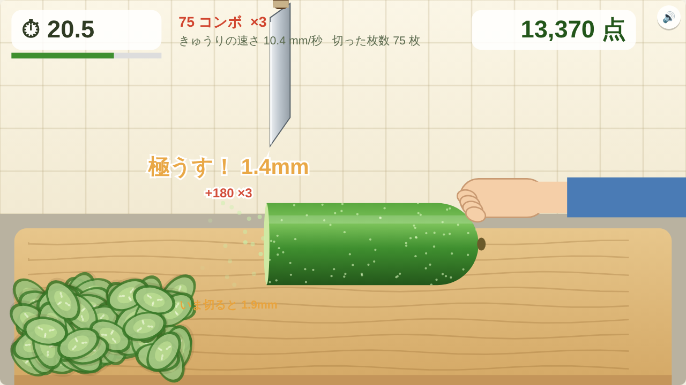
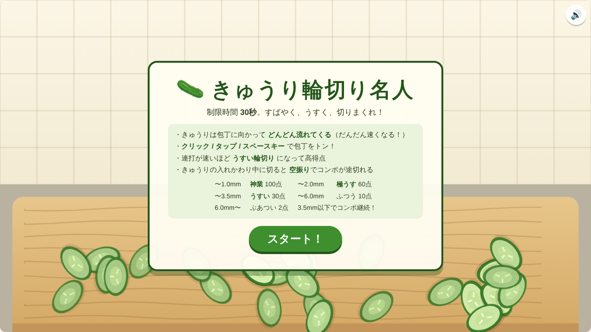
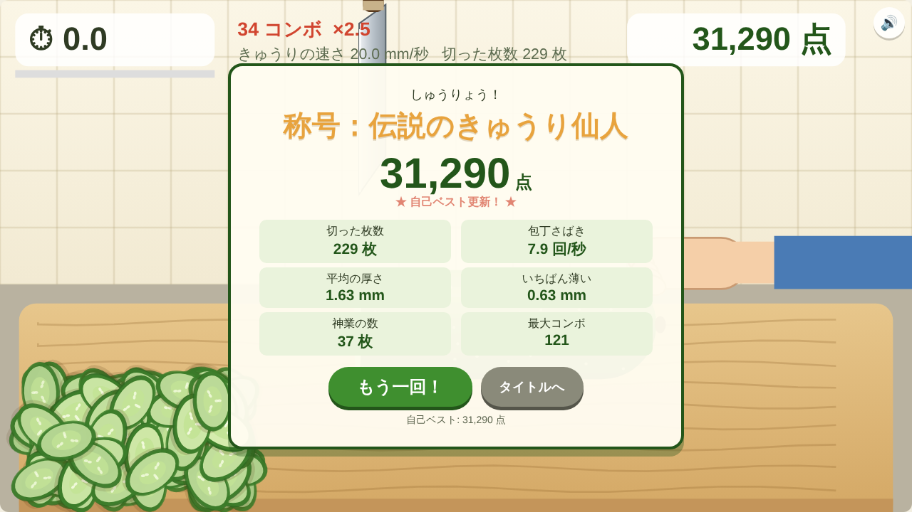

<!--
==============================
WordPress 投稿用メタ情報（本番公開時に設定）
==============================
タイトル案（32文字前後）:
  Claude Code ゲーム制作体験記｜一言の指示で効果音つきブラウザゲームが完成した話
スラッグ: claude-code-game-cucumber
フォーカスキーワード: Claude Code ゲーム制作
メタディスクリプション（120字前後）:
  Claude Code でゲーム制作に挑戦。「きゅうりの輪切りゲームを作って」という日本語の一言から、効果音つきブラウザゲームの実装・動作テスト・GitHub への公開までを開発者目線で振り返ります。つまずいた GitHub の権限エラーの解決法も紹介。
カテゴリ案: AI開発 / ゲーム制作
タグ案: Claude Code, 生成AI, ゲーム制作, JavaScript, Web Audio API, GitHub
アイキャッチ: images/play.png
公開前に差し替える箇所: 【ゲームの公開URL】（2か所）
-->

# Claude Code ゲーム制作体験記｜一言の指示で効果音つきブラウザゲームが完成した話

「きゅうりの輪切りをモチーフにしたWEBゲームを作ってください。できるだけ包丁を早くさばき、そしてきゅうりもうすくカットすることを競うゲームです。効果音もつけてください」

Claude Code でのゲーム制作は、この日本語の一文から始まりました。空っぽの GitHub リポジトリを用意して指示を出しただけで、遊べるブラウザゲーム「きゅうり輪切り名人」ができあがりました。

この記事では、Claude Code に何を任せ、どこで人間がつまずいたのかを、開発者目線で正直に振り返ります。

▶ 実際に遊べます：【ゲームの公開URL】

## 作ったゲーム「きゅうり輪切り名人」

ルールはシンプルです。

- 制限時間は30秒
- きゅうりがまな板の上を包丁に向かって流れてくる（だんだん速くなる）
- クリック、タップ、スペースキーで包丁を振り下ろす
- 速く連打するほど輪切りが薄くなり、高得点になる

指示では「速さ」と「薄さ」を競うとだけ伝えていました。Claude Code はこの2つを、ひとつの仕組みにまとめてきました。

> 輪切りの厚さ ＝ きゅうりが流れる速さ × 前回切ってからの時間

つまり、包丁を速くさばくほど自然と薄く切れます。きゅうりは毎秒6mmから20mmまで加速していくので、後半ほど連打の速さが求められます。

厚さごとの評価と得点は次のとおりです。

| 厚さ | 評価 | 得点 |
| --- | --- | --- |
| 1.0mm 未満 | 神業 | 100点 |
| 2.0mm 未満 | 極うす | 60点 |
| 3.5mm 未満 | うすい | 30点 |
| 6.0mm 未満 | ふつう | 10点 |
| 6.0mm 以上 | ぶあつい | 2点 |

3.5mm 未満が続くとコンボになり、得点の倍率が最大3倍まで上がります。

ただ連打するだけのゲームにしない工夫もありました。1本切り終わって次のきゅうりが入ってくる間に包丁を下ろすと「空振り」になり、コンボが途切れます。画面をよく見てリズムを取る必要があるわけです。こうしたゲームバランスの部分は、こちらから指示していません。

## Claude Code に任せたこと

### 1. 実装：HTML ファイル1枚、ライブラリなし

できあがったのは `index.html` 1枚です。外部ライブラリは使っていません。

- 描画は Canvas。まな板、きゅうり、包丁、輪切りの断面（皮・果肉・種）まですべてコードで描いています
- 薄く切った輪切りほど半透明になる、という細かい演出も入っていました
- スマホのタップにも対応しています
- 自己ベストはブラウザに保存されます

### 2. 効果音：音声ファイルを使わずにその場で合成

「効果音もつけて」という一言に対しては、Web Audio API を使い、音をプログラムで合成する方法が選ばれました。音声素材を用意したりライセンスを気にしたりする必要がありません。

用意された効果音は次のとおりです。

- 切ったときの「シャキッ」（高音のノイズ）と、まな板の「トン」（低い音）の組み合わせ
- 厚く切ったときの「ドスッ」
- 空振りの「スカッ」
- 「神業」が出たときの「キラーン」
- 10コンボごとのジングル、コンボが途切れた音
- スタート前のカウントダウン、残り5秒のチクタク、終了のファンファーレ

右上のボタンで消音もできます。

### 3. 動作テスト：ブラウザを自動操作して確認

Claude Code は、作って終わりにはしませんでした。クラウド環境にあるブラウザ（Playwright）でゲームを開き、自動でクリックを連打して最後までプレイし、画面のスクリーンショットを撮って確認していました。

その確認で、連打すると「極うす！ 1.7mm」といった評価の文字が何重にも重なって読めない、という問題が見つかりました。最新の評価だけを表示するように、その場で直しています。

人間がテストプレイする前に、見た目の不具合まで拾ってくれたのは大きかったです。

ちなみに上の結果画面は、自動テストで1秒に約8回クリックし続けたときのものです。229枚を平均1.63mm で切り、最高の称号「伝説のきゅうり仙人」になりました。機械の連打で最高ランクに届いてしまうので、得点バランスはまだ調整の余地があります。

## つまずいたところ：GitHub への push が 403 エラー

順調だったのはここまでです。完成したコードを GitHub に push しようとしたところ、403 エラーで止まりました。

原因は、リポジトリのある GitHub 組織に「Claude GitHub App」がインストールされていなかったことでした。

ここで私は、組織の「メンバー」一覧を探してしまいました。しかし GitHub App はメンバー（人）ではありません。組織やリポジトリに「インストール」するものなので、メンバー一覧には出てきません。

解決の手順は次のとおりです。

1. 組織の Settings を開く（`https://github.com/organizations/組織名/settings/installations` が早いです）
2. 左メニューの「Third-party Access」→「GitHub Apps」で、Claude が入っているか確認する
3. 入っていなければ `https://github.com/apps/claude/installations/select_target` から組織を選び、対象のリポジトリへのアクセスを許可してインストールする

組織の Settings は、組織のオーナーにしか表示されません。タブが見つからない場合は、オーナー権限があるかを確認してください。

インストール後に Claude Code へ「終わりました」と伝えると、すぐに push が通りました。

## プルリクエストは必要？

push の後、「プルリクエストを作るメリット」も聞いてみました。

チームで開発するなら、変更を本番に入れる前にレビューできることや、やり取りが記録に残ることが利点です。一方で今回のように空のリポジトリから始めた場合、作業ブランチがそのまま唯一のブランチになるので、取り込み先がなくプルリクエストは作れません。続けて改良するなら、`main` ブランチを作ってから作業ブランチで変更し、プルリクエストで取り込む流れにすると整理しやすい、という説明でした。

## Claude Code でゲーム制作をしてみた感想

- **一言の指示でも「遊べる形」まで持っていってくれる**：ルールの細部、得点表、称号、効果音まで、指示していない部分も自分で設計して提案してくれました。
- **テストまでやってくれる**：自分でブラウザを動かして画面を確認し、不具合を直してから渡してくれるのは、開発者としてありがたい点です。
- **人間の出番は権限まわり**：GitHub App のインストールのように、アカウントや組織の権限が絡む作業は人間がやる必要があります。エラーの原因と、どの画面を開けばいいかは Claude Code が具体的に教えてくれました。

次は、機械の連打で最高ランクになってしまう得点バランスの調整や、ランキング機能の追加に挑戦してみる予定です。

▶ きゅうり輪切り名人で遊ぶ：【ゲームの公開URL】
